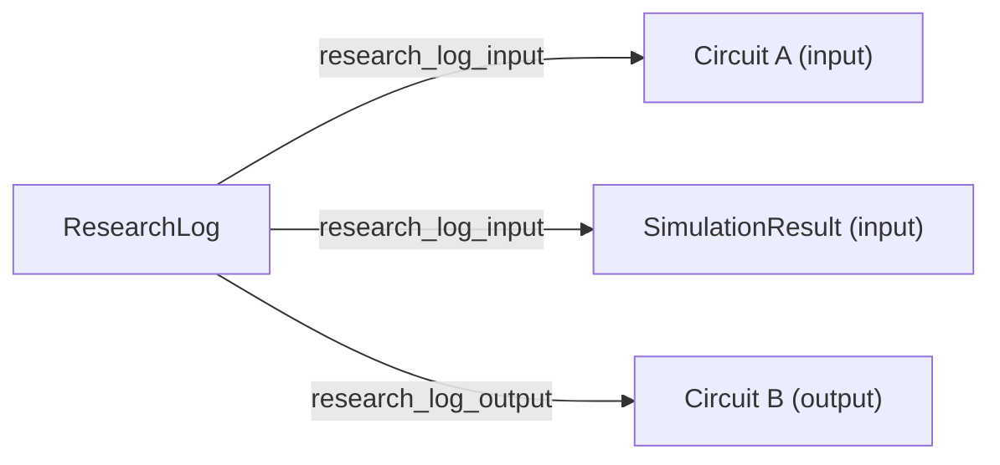

# ResearchLog entity

- Status: Draft
- Date: 2026-10-14
- Author: @GianlucaFicarelli
- Issues: [prod-ai#131](https://github.com/openbraininstitute/prod-ai/issues/131), [entitycore#534](https://github.com/openbraininstitute/entitycore/issues/534)
- Pull requests: [#731](https://github.com/openbraininstitute/entitycore/pull/731)

## Context

Agents running in the MCP sandbox produce a markdown logbook describing a research session. Today it lives only in the user's sandbox home directory, so it is visible to its creator alone. Storing it as an entity makes it shareable with the other members of the project, through the standard `authorized_project_id` / `authorized_public` rules, and lets the platform list it under `Reports`.

Only the ResearchLog is addressed now. Figures and data tables produced in the same sessions are deferred (see Alternatives considered).

## Decision

### Entity

`ResearchLog` is a direct child of `Entity`, modelled on `AnalysisNotebookResult`: a named, described, project-scoped document whose content lives in its assets, with standard CRUD and no foreign keys.

```python
class ResearchLog(Entity, NameDescriptionVectorMixin):
    """Markdown logbook of a research session, e.g. produced by an agent in the MCP sandbox.

    Attributes:
        id (uuid.UUID): Primary key, referencing the entity ID.
        category (str | None): Free-text category used to group research logs.

    Assets:
        - a markdown file with label `research_log_document`.
        - an optional directory with label `research_log_files`.
    """

    __tablename__ = EntityType.research_log.value
    id: Mapped[uuid.UUID] = mapped_column(ForeignKey("entity.id"), primary_key=True)
    category: Mapped[str | None] = mapped_column(index=True)
    __mapper_args__ = {"polymorphic_identity": __tablename__}
```

`category` is an optional free-text string to group ResearchLogs (e.g. by topic or workflow), available as a filter. The API is otherwise the standard one for entities, including the generic asset endpoints.

### Assets

| Label | Kind | Content type | Purpose |
|---|---|---|---|
| `research_log_document` | file | `text/markdown` (new `ContentType.markdown`, suffixes `.md`, `.markdown`) | The logbook |
| `research_log_files` | directory | — | Files embedded or referenced by the logbook (figures, small data files) |

The label names the role of the file, not its format, so other formats can be accepted later by adding content types to the label. Links in the markdown are relative paths inside the `research_log_files` directory (e.g. ``), so the frontend can resolve them through the directory listing and download endpoints.

### Links to other entities

A ResearchLog is linked to the inputs of the session (e.g. the circuit analysed) and to its outputs (e.g. a circuit produced during the session) with the existing `Derivation`, using two new derivation types:

| Link | `generated_id` | `used_id` | `derivation_type` |
|---|---|---|---|
| Input | ResearchLog | input entity | `research_log_input` |
| Output | ResearchLog | output entity | `research_log_output` |



- The ResearchLog is always the generated entity, so all its links are on the same side and the type tells inputs from outputs.
- Links are created with `POST /derivation`, which already requires the linked entity to be readable and the ResearchLog to be writable. They can be added one at a time while the session runs.
- For these two types the service must check that the generated entity is a ResearchLog; derivation types are not restricted to entity types today.

The existing endpoints are enough to read the links:

- inputs or outputs of a ResearchLog: `GET /research-log/{id}?expand=generated_from_derivations:research_log_input` (or `:research_log_output`; repeat `expand` for both)
- the ResearchLogs that used an entity: `GET /circuit/{id}?expand=used_by_derivations:research_log_input`, or `GET /research-log?generated_derivation__used_id=<id>&generated_derivation__derivation_type=research_log_input` to search the ResearchLogs
- the ResearchLog that produced an entity: `GET /circuit/{id}?expand=used_by_derivations:research_log_output`

## Alternatives considered

- **Three entities (ResearchLog, Figure, DataTable).** Proposed in prod-ai#131. Figures and tables need their own metadata (caption, columns) whose shape is still unclear; they may become specialized entities later or reuse the generic dataset entity of entitycore#534. Until then, the files of a ResearchLog are stored in its `research_log_files` directory.
- **A single generic entity with several assets.** It would group the files, but mixes concepts that the platform displays differently (reports vs. data).
- **Child of `ScientificArtifact`.** A ResearchLog has no brain region, species, subject, or license.
- **`category` as an enum.** The useful values are not known yet. It can become an enum once conventions emerge.
- **A single derivation type, ResearchLog always generated.** Inputs and outputs could not be told apart.
- **Direction gives the meaning (input: ResearchLog generated; output: ResearchLog used), with one or two types.** A ResearchLog could not be deleted while any output is linked to it (`used_id` has no cascade), and an output link could be removed only with deletion rights on the output. "The circuit was derived from the ResearchLog" also does not describe what happened. With two types, the type would only repeat the direction and the service would have to keep them consistent.
- **A "research session" activity**, using the inputs and generating the ResearchLog and the outputs, like `AnalysisNotebookExecution` for `AnalysisNotebookResult`. It is closer to PROV, but needs a new activity type for a session that has no start time, end time or status of its own (`status` is required on activities). With the current code an activity also gets its used entities only at creation and its generated entities only once, so the whole session would have to be registered at the end. Derivations can be migrated to an activity if sessions get metadata of their own.

## Consequences

Derivations follow the permissions of the ResearchLog (the generated entity), whatever the visibility of the linked entity:

| Action | ResearchLog private | ResearchLog public |
|---|---|---|
| Create a derivation | members of the ResearchLog's project | service maintainers of the project only |
| Delete a derivation | the ResearchLog's creator or a project admin | service maintainers of the project only |
| Delete the ResearchLog, with its derivations | the ResearchLog's creator or a project admin | service maintainers of the project only |

- The linked entity only needs to be readable by the user creating the derivation: public, or in one of the user's projects. A ResearchLog can therefore link public entities and private entities of other projects the user belongs to.
- Deleting a ResearchLog deletes its derivations (`ON DELETE CASCADE` on `generated_id`), not the linked inputs and outputs.
- A linked entity, public or private, cannot be deleted while a derivation links it to a ResearchLog (`used_id` has no cascade), as for any derivation today. Removing the derivation requires the rights on the ResearchLog in the table above, so the owner of a linked entity in another project cannot do it alone.
- Once a ResearchLog is public its links are fixed for regular users, so the agent should add them before publishing.
- `GET /derivation` returns a derivation only if both entities are readable, but `expand` on a ResearchLog does not filter the linked entities: readers see the basic fields (id, type, project, visibility, lifecycle status) of linked entities they cannot read, e.g. a private entity of another project. This is the current behaviour for all derivations.
- `category` values are not curated: consistency is left to the users and agents writing the ResearchLogs.
- As for other entities, assets cannot be required at creation: a ResearchLog may exist without its markdown file until it is uploaded.

## Follow-ups

- entitysdk: `ResearchLog` model, upload helpers and derivation helpers.
- Platform: display ResearchLogs under `Reports`, rendering the markdown and resolving relative links against `research_log_files`.
- Figures and data tables (entitycore#534).
